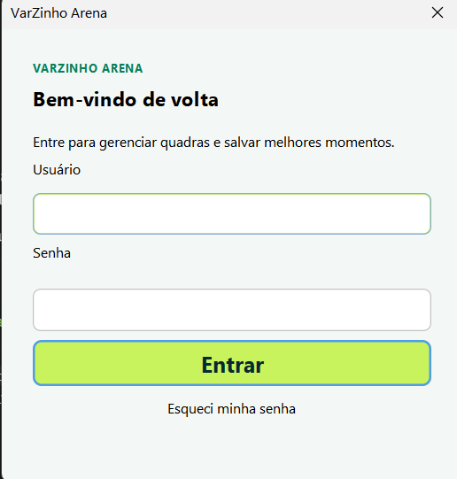
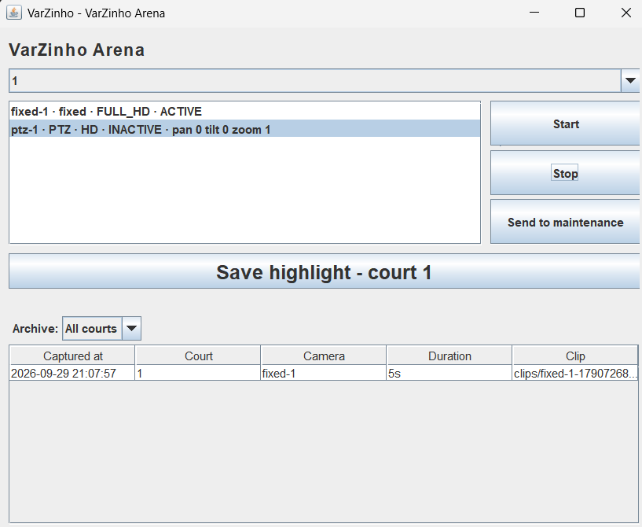
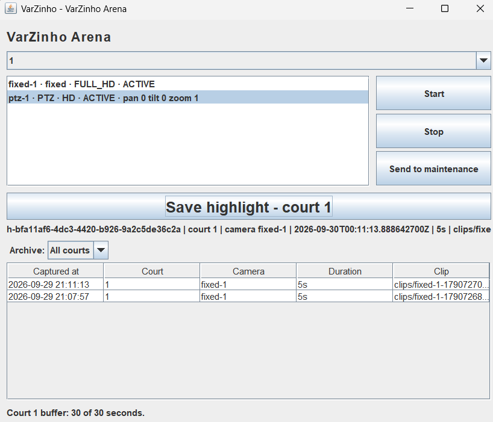
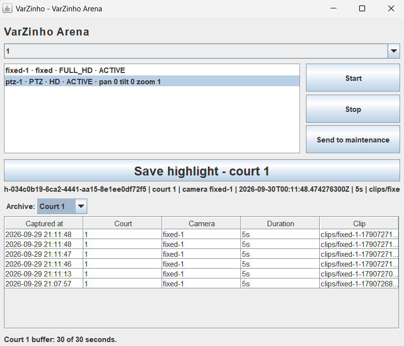
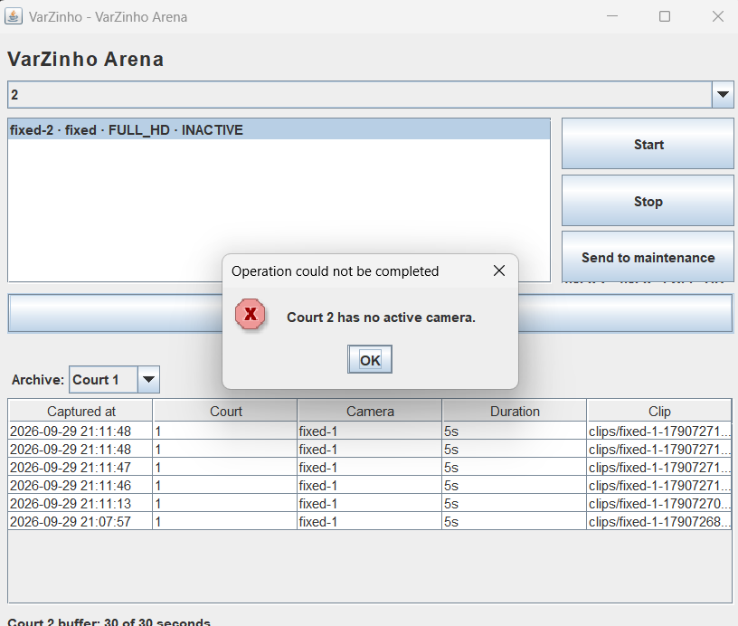

# VarZinho

> O sistema não filma o lance. Ele lembra dele.

Sistema de captura de lances para ginásios esportivos. As câmeras gravam
continuamente em um buffer circular de 30 segundos; quando acontece um gol ou
uma jogada bonita, o atleta aciona um botão e aquele trecho é salvo como vídeo
permanente. Depois é só pedir o vídeo ao operador, que tem o acervo inteiro.

O foco é futebol, mas o sistema não conhece esporte nem tipo de jogada: serve a
qualquer modalidade que o ginásio jogue.

## A regra central

**O acionamento não inicia a gravação. Ele preserva o que já foi gravado.**

Quando o lance acontece, ele já terminou. Se o botão apenas iniciasse a
gravação, o lance estaria perdido. Por isso a câmera grava de forma contínua
em um buffer circular que retém os últimos 30 segundos e descarta
automaticamente o conteúdo mais antigo.

Essa regra explica quase todas as decisões do projeto — inclusive por que o
lance não registra ninguém: no momento da captura não existe nenhuma camada de
identificação de usuário, apenas um botão sendo apertado. Quem quer o vídeo
procura o operador, que localiza pela quadra e pelo horário.

## Sobre o projeto

Trabalho da disciplina **AL0330 — Programação Orientada a Objetos**
(Engenharia de Software, Unipampa Alegrete, 2026/2).

O objetivo é a **modelagem do domínio** — classes, relacionamentos,
encapsulamento, herança, polimorfismo e tratamento de exceções. O sistema é
operado por uma interface gráfica mínima em Swing, exigida pelo enunciado, e
verificado por testes automatizados.

Na versão 2.0, um celular pode servir de câmera: o lance capturado por ele vira
um arquivo `.mp4` de verdade, que abre no player. Quem grava e corta o vídeo é o
FFmpeg, um programa externo — o Java não decodifica nenhum quadro. As câmeras
fixa e PTZ continuam guardando só os metadados do clipe: caminho, duração,
resolução e tamanho.

## Tecnologias

- Java 17 (LTS)
- Maven
- JUnit 5
- FlatLaf, FlatLaf Extras e MigLayout Swing — interface gráfica, aprovados na [#158](https://github.com/lorenzoficher/VarZinho/issues/158)
- FFmpeg — opcional, só para a captura com o celular
- PostgreSQL, via Docker — opcional, só para o banco de dados

## Instalando o Maven

Você precisa do JDK 17 (ou superior) e do Maven. O build para com uma mensagem
clara se o JDK for anterior ao 17.

| Sistema | Comando |
|---|---|
| Windows | `choco install maven` num terminal de administrador — depois **feche e reabra o terminal**. Sem o Chocolatey: baixe o zip em <https://maven.apache.org/download.cgi>, extraia e adicione a pasta `bin` ao `PATH` (o pacote `Apache.Maven` não existe no `winget`) |
| macOS | `brew install maven` |
| Linux (Debian/Ubuntu) | `sudo apt install maven` |

Para conferir a instalação:

```bash
java -version   # deve mostrar 17 ou superior
mvn -v          # deve mostrar a versão do Maven e o mesmo JDK
```

## Como executar

```bash
mvn compile
mvn test
mvn exec:java
```

`mvn exec:java` abre a janela Swing ([Main](src/main/java/br/edu/unipampa/varzinho/Main.java)
→ [Launcher](src/main/java/br/edu/unipampa/varzinho/bootstrap/Launcher.java)
→ [SignInDialog](src/main/java/br/edu/unipampa/varzinho/ui/SignInDialog.java)
→ [VarZinhoWindow](src/main/java/br/edu/unipampa/varzinho/ui/VarZinhoWindow.java)).
Antes da janela principal, um operador precisa entrar com usuário e senha. Na
primeira execução, sem nenhum operador salvo, aparece o formulário que cria o
primeiro. A senha precisa de 8 caracteres, com maiúscula, minúscula, dígito e
símbolo. Fechar esse formulário encerra o programa; fechar a janela principal
encerra a sessão.

Os lances salvos ficam em `data/highlights.csv`, as quadras e câmeras em
`data/gym.csv` e os operadores em `data/operators.csv`, guardando só o hash da
senha. Tudo reaparece na próxima execução.

Há também uma demonstração em modo texto, sem janela, que percorre o fluxo
inteiro — monta o ginásio, as quadras e as câmeras, grava, captura, salva,
recarrega do CSV e provoca o erro de quadra sem câmera ativa. Ela não pede login
e usa sempre o CSV:

```bash
mvn compile exec:java -Dexec.mainClass=br.edu.unipampa.varzinho.ConsoleDemo
```

No PowerShell, coloque a propriedade entre aspas:

```powershell
mvn compile exec:java "-Dexec.mainClass=br.edu.unipampa.varzinho.ConsoleDemo"
```

### Captura real com o celular

Precisa do FFmpeg e de um celular na mesma rede Wi-Fi do computador.

1. Instale o FFmpeg (`winget install Gyan.FFmpeg`) e **abra um terminal novo**.
   Confira com `ffmpeg -version`. No Windows, o VarZinho também procura o executável
   na instalação do WinGet caso o terminal ou o VS Code ainda esteja com o PATH antigo.
2. No celular, instale um app que transmita a câmera por HTTP — *IP Webcam*
   (Android) ou *DroidCam* (Android/iOS) — e inicie o servidor. Anote o
   endereço, por exemplo `http://192.168.0.42:8080/video`.
3. Teste no computador: `ffplay http://192.168.0.42:8080/video` precisa mostrar
   a imagem. Se não abrir, confira o firewall; redes de universidade costumam
   isolar os aparelhos — use o roteador do próprio celular.
4. Rode com o endereço na variável `VARZINHO_STREAM_URL`:

```powershell
$env:VARZINHO_STREAM_URL = "http://192.168.0.42:8080/video"
mvn exec:java
```

O celular aparece como a câmera `phone-1`, numa quadra só dele. Depois de 30
segundos gravando, **Salvar Melhor Momento** grava o `.mp4` em `clips/`, e **Assistir ao vídeo**,
no acervo, abre os detalhes. **Abrir transmissão ao vivo** mostra a imagem do celular no
navegador. Se o celular sair da rede, a janela avisa e a quadra dele deixa de
capturar; para reconectar, reinicie o programa.

Para usar o mesmo celular nas próximas inicializações, coloque o endereço completo do vídeo em
`data/stream-url.txt` (uma linha). Esse arquivo fica só na sua máquina. Se estiver definida,
a variável `VARZINHO_STREAM_URL` tem prioridade.

Também é possível conectar durante a sessão. No dashboard, clique em **Abrir transmissão ao vivo**,
logo abaixo de **Salvar Melhor Momento**, e cole o endereço completo do IP Webcam. Quando o
FFmpeg receber o primeiro trecho, o VarZinho selecionará a quadra do celular automaticamente.
Confira **phone-1 · grava vídeo MP4** e aguarde o buffer. Uma câmera cadastrada manualmente como
**Fixa** ou **PTZ** é simulada, mesmo que receba um nome como `phone01`. No histórico,
**Sem MP4** identifica os registros cujo arquivo de vídeo não está disponível.

### Transmissão para espectadores e compra de um lance (#188)

O operador continua usando a janela Java. O espectador abre um link HTTPS no navegador,
assiste à quadra do celular e pode comprar os 30 segundos que acabou de ver por **R$ 5,00**.
O relógio usado é o do vídeo. A arena mantém cerca de 2 minutos e meio de segmentos para
reservar um lance mesmo com atraso de reprodução. Se o trecho já expirou, o Pix não é gerado.

**Teste com espectadores no 4G ou em outro Wi-Fi.** Instale o utilitário de túnel no
Windows uma vez com `winget install --id Cloudflare.cloudflared --exact`.
Feche a janela anterior do VarZinho. Na pasta do projeto, rode:

```powershell
$env:VARZINHO_DEMO = "public"
mvn compile exec:java
```

Conecte a câmera e clique em **Copiar link público**. Com o aplicativo e o celular
ligados, qualquer pessoa com esse link pode ver a quadra. O túnel temporário usa
somente a página dos espectadores e fecha com o VarZinho.
Se aparecer um aviso de falha do túnel, a demonstração continua disponível no computador.
Para um teste restrito ao notebook, use `$env:VARZINHO_DEMO = "local"`.

Depois de 30 segundos de partida, o espectador pode clicar em **Simular compra**
e **Confirmar compra de teste** para assistir ao MP4 do lance. A demonstração dispensa
CPF, e-mail e Pix. Os clipes de teste ficam em `data/spectator/demo-orders/`.
Para voltar ao modo normal, feche o aplicativo, execute
`Remove-Item Env:VARZINHO_DEMO` no mesmo PowerShell e reinicie.

**Uso com Pix real e endereço estável**

1. Configure a captura local com o celular e o FFmpeg conforme a seção anterior.
2. Disponibilize um endereço HTTPS exclusivo para a arena. Configure o proxy reverso ou
   túnel HTTPS desse endereço para encaminhar as requisições para `http://127.0.0.1:8787`
   no computador da arena. Compartilhe apenas o endereço público. Exponha somente o serviço
   do espectador; a câmera, a janela do operador e o banco ficam na rede privada.
3. Configure o Pix na conta recebedora do Mercado Pago. Use o token de teste e os dados de
   teste do provedor durante a homologação. No PowerShell em que o aplicativo vai rodar,
   configure as variáveis (substitua o domínio de exemplo):

   ```powershell
   $env:VARZINHO_PUBLIC_URL = "https://arena.exemplo.com.br"
   $credencialPix = Read-Host "Access Token do Mercado Pago" -AsSecureString
   $env:VARZINHO_PIX_TOKEN = [System.Net.NetworkCredential]::new("", $credencialPix).Password
   mvn compile exec:java
   ```

4. Na quadra do celular, use **Abrir transmissão ao vivo** para abrir a página e
   **Copiar link público** para compartilhá-la. Abra o link em outro celular usando dados móveis.
   Use um navegador com suporte a vídeo H.264 por MediaSource. Quando houver 30 segundos
   de partida, clique em **Comprar este lance**, informe o e-mail e o CPF do pagador e gere o Pix.
   Em homologação, preencha os dados fictícios indicados pelo provedor.
5. Guarde o endereço privado do pedido. O servidor consulta o pagamento com a credencial
   da arena e confere o pedido, o valor e a moeda antes de liberar a reprodução e o download.
   Cada pessoa com esse endereço privado pode acessar o pedido. Mantenha o aplicativo e o
   proxy ligados enquanto houver espectadores ou compradores acessando os vídeos.

Os pedidos e MP4s ficam em `data/spectator/orders/`. Preserve essa pasta entre execuções
e inclua-a no backup da arena. Reservas sem início de pagamento expiram após uma hora na
próxima reserva. Há espaço para até 200 pedidos pendentes simultâneos. Os lances já liberados
não consomem essa cota. Ao atingir a capacidade, novas reservas são recusadas antes da cobrança.
Sem `VARZINHO_PUBLIC_URL`, o botão da janela abre a página dos espectadores apenas neste computador e a cópia
do link público fica desabilitada. O endereço HTTPS também pode ser usado sem credencial
Pix para testar a transmissão em outra rede. Nesse caso a compra fica indisponível.

Para validar localmente sem movimentar dinheiro, rode
`mvn test -Dtest=SpectatorTest,PublicMatchTest` (no PowerShell, coloque o argumento
`-Dtest=SpectatorTest,PublicMatchTest` entre aspas). O teste com vídeo precisa de
`ffmpeg` e `ffprobe` no PATH, gera uma partida sintética e usa um provedor Pix simulado.

### Banco de dados PostgreSQL

Por padrão tudo fica nos arquivos CSV de `data/`. Para usar o PostgreSQL você
precisa do Docker (Docker Desktop no Windows e no macOS) aberto. A partir de um
clone novo, na raiz do repositório:

1. Suba o banco. O [docker-compose.yml](docker-compose.yml) usa a imagem
   `postgres:16.15-alpine`:

   ```bash
   docker compose up -d
   docker compose ps     # espere o serviço postgres aparecer como "healthy"
   ```

   Isso sobe um PostgreSQL em `127.0.0.1:5432`, com banco, usuário e senha
   `varzinho`. Os dados ficam no volume `varzinho-data` e sobrevivem a reiniciar
   ou recriar o container; só `docker compose down -v` os apaga
   (`docker compose down` para o banco e mantém os dados).

2. Indique o banco à aplicação e abra a janela. No PowerShell:

   ```powershell
   $env:VARZINHO_DATABASE_URL = "jdbc:postgresql://localhost:5432/varzinho"
   $env:VARZINHO_DATABASE_USER = "varzinho"
   $env:VARZINHO_DATABASE_PASSWORD = "varzinho"
   mvn compile exec:java
   ```

   No bash (Linux, macOS ou Git Bash):

   ```bash
   export VARZINHO_DATABASE_URL=jdbc:postgresql://localhost:5432/varzinho
   export VARZINHO_DATABASE_USER=varzinho
   export VARZINHO_DATABASE_PASSWORD=varzinho
   mvn compile exec:java
   ```

3. As tabelas são criadas sozinhas na primeira conexão — não há script para
   rodar. Como o banco começa vazio, a primeira tela é a de criar o primeiro
   operador, e a janela abre sobre o ginásio de exemplo. Daí em diante, as
   quadras, as câmeras, os lances e os operadores ficam no banco.

| Variável | Quem lê | Para quê |
|---|---|---|
| `VARZINHO_DATABASE_URL` | aplicação | Endereço JDBC do banco. Definida, o ginásio, o acervo e os operadores vão para o PostgreSQL; ausente ou vazia, para os CSV de `data/` |
| `VARZINHO_DATABASE_USER` | aplicação | Usuário do banco. Obrigatória quando a URL está definida |
| `VARZINHO_DATABASE_PASSWORD` | aplicação | Senha do banco |
| `VARZINHO_DB_NAME`, `VARZINHO_DB_USER`, `VARZINHO_DB_PASSWORD` | `docker compose` | Nome do banco, usuário e senha criados no container (padrão `varzinho` nos três) |
| `VARZINHO_DB_PORT` | `docker compose` | Porta do computador ligada ao banco (padrão `5432`) |

As variáveis `VARZINHO_DB_*` só valem para o `docker compose`; a aplicação lê
apenas as `VARZINHO_DATABASE_*`. Se você mudar uma delas, ajuste a outra. Por
exemplo, com a porta 5432 ocupada, suba com `VARZINHO_DB_PORT=5433 docker compose up -d`
(no PowerShell, `$env:VARZINHO_DB_PORT = "5433"` antes do comando) e use
`jdbc:postgresql://localhost:5433/varzinho` na URL. O nome, o usuário e a senha
só são aplicados quando o volume é criado; para trocá-los depois, apague o
volume com `docker compose down -v`.

Sem `VARZINHO_DATABASE_URL`, tudo continua nos arquivos de `data/`. Se o banco
indicado não responder, o programa mostra o erro e não abre: ele **não** volta a
gravar em CSV, para que nenhum lance fique num arquivo enquanto você o procura no
banco. A mensagem mostra o endereço do banco, nunca a senha.

Com o Docker instalado, `mvn test` também testa contra um PostgreSQL de verdade;
sem ele, esses testes são pulados.

### O que a interface faz

Na primeira execução, a janela abre sobre um ginásio de exemplo já montado
([SampleGym](src/main/java/br/edu/unipampa/varzinho/bootstrap/SampleGym.java)): a
quadra 1 tem uma câmera fixa e uma PTZ, a quadra 2 tem uma câmera fixa, e todas
já estão gravando. Depois disso, ela abre sobre o ginásio salvo em
`data/gym.csv` (ou no banco, se `VARZINHO_DATABASE_URL` estiver definida), com as
quadras, câmeras, estados e posições deixados na execução anterior. Um relógio de um segundo alimenta os buffers enquanto a
janela está aberta.

Antes de tudo, a janela de entrada
([SignInDialog](src/main/java/br/edu/unipampa/varzinho/ui/SignInDialog.java)) pede
usuário e senha:

- Na primeira execução, sem nenhum operador salvo, ela pede o nome, o usuário e a
  senha do primeiro operador. A senha precisa de 8 caracteres, com maiúscula,
  minúscula, dígito e símbolo, e só o hash dela é guardado.
- Nas seguintes, **Entrar** confere o usuário e a senha. Um erro nunca diz qual
  dos dois estava errado.
- **Esqueci minha senha** abre uma recuperação simulada: informe o usuário e um
  e-mail, clique em **Prosseguir** no lugar do link que chegaria por e-mail e
  escolha a nova senha. Nenhum e-mail é enviado.
- Depois de entrar, a página **Operadores** cadastra outro operador, que poderá
  entrar na próxima execução.

<!-- SCREENSHOT PENDENTE: salve a captura da janela de entrada em
     docs/screenshots/05-entrada-do-operador.png e troque este comentário por:


*Entrada do operador: usuário e senha antes da janela principal.*
-->

O **Dashboard** abre após o login. Escolha a quadra no cabeçalho ou em **Suas quadras**. O painel mostra as câmeras dessa quadra e quantos segundos já chegaram ao buffer. A modalidade escolhida nos botões vale para a quadra durante a sessão.

- Em **Quadras**, informe o número para cadastrar uma quadra. Ela passa a aparecer no dashboard e nos filtros.
- Para instalar várias câmeras, selecione a quadra, preencha o formulário e clique em **Cadastrar câmera**. Para a próxima, informe outro ID e ajuste os demais campos se necessário. A página lista as câmeras da quadra. Cada nova câmera começa parada e pode ser iniciada em **Câmeras**.
- Em **Câmeras**, use **Iniciar**, **Parar** ou **Liberar** na linha da câmera. O menu **Ações** permite movê-la para outra quadra, configurá-la, enviá-la para manutenção ou removê-la. Em **Movimento PTZ**, selecione uma câmera compatível para ajustar panorâmica, inclinação e zoom.
- Quando o buffer atingir 30 segundos, clique em **Salvar Melhor Momento**. O histórico mostra a quadra, a câmera, a data e a duração do lance confirmado.
- Selecione uma gravação no histórico e use **Renomear gravação** para dar um nome como “Lance Fernando Costa”. O nome fica salvo no acervo e aparece na busca. **Excluir gravação** pede confirmação e abre com **Cancelar** selecionado. Ao confirmar, o sistema remove o registro e o MP4 original em `clips/`, quando existir. Cópias exportadas ficam com quem as salvou.
- **Melhores momentos** reúne captura e histórico. Em **Arquivos**, use a busca, a quadra e o filtro **Hoje** para localizar uma gravação. A categoria pode ser editada durante a sessão. Para um MP4 real do celular, **Assistir** abre os detalhes, com opções de reprodução no player do sistema e de cópia do vídeo. As câmeras simuladas geram registros de lances.
- No histórico, **Ctrl+F** leva à busca. Digite, por exemplo, o ID de uma câmera, uma data ou a categoria **Defesa**. **Enter** seleciona o primeiro resultado. Use as setas para escolher outro lance e **Ctrl+Enter** na tabela para abrir o selecionado. **Esc** no campo de busca limpa o texto.
- Em **Configurações**, alterne entre os temas claro e escuro ou escolha um nome de exibição para a quadra durante a sessão. A barra de mensagens e o sino do cabeçalho mostram o retorno das operações.

## Principais classes

Caminhos relativos a `src/main/java/br/edu/unipampa/varzinho/`.

| Classe | Pacote | Papel |
|---|---|---|
| [`Gym`](src/main/java/br/edu/unipampa/varzinho/domain/structure/Gym.java) | `domain.structure` | O ginásio: registra quadras e câmeras, e recusa números de quadra e identificadores de câmera repetidos |
| [`Court`](src/main/java/br/edu/unipampa/varzinho/domain/structure/Court.java) | `domain.structure` | A quadra: instala e remove câmeras e dispara a captura (`triggerCapture()`) |
| [`Camera`](src/main/java/br/edu/unipampa/varzinho/domain/capture/Camera.java) | `domain.capture` | Abstrata. Controla o estado da câmera e o seu buffer; cada subtipo produz o clipe à sua maneira |
| [`FixedCamera`](src/main/java/br/edu/unipampa/varzinho/domain/capture/FixedCamera.java), [`PtzCamera`](src/main/java/br/edu/unipampa/varzinho/domain/capture/PtzCamera.java) | `domain.capture` | Câmera fixa, com ângulo definido na instalação; câmera de cabeça móvel (*pan-tilt-zoom*), com giro, inclinação e zoom validados |
| [`StreamCamera`](src/main/java/br/edu/unipampa/varzinho/domain/capture/StreamCamera.java) | `domain.capture` | O celular no tripé. Grava como as outras câmeras, mas o seu lance vira um arquivo de vídeo real, escrito pelo `ClipAssembler` |
| [`ClipAssembler`](src/main/java/br/edu/unipampa/varzinho/domain/capture/ClipAssembler.java) | `domain.capture` | Interface: transforma os segundos guardados num arquivo de vídeo. É tudo o que o domínio sabe sobre vídeo real |
| [`CircularBuffer`](src/main/java/br/edu/unipampa/varzinho/domain/capture/CircularBuffer.java) | `domain.capture` | Memória de tamanho fixo que sobrescreve o quadro mais antigo |
| [`Frame`](src/main/java/br/edu/unipampa/varzinho/domain/capture/Frame.java) | `domain.capture` | Um segundo de gravação: instante e posição na sequência, sem imagem |
| [`Highlight`](src/main/java/br/edu/unipampa/varzinho/domain/highlight/Highlight.java) | `domain.highlight` | O lance salvo, imutável: quando, em que quadra, por qual câmera e qual clipe |
| [`VideoClip`](src/main/java/br/edu/unipampa/varzinho/domain/highlight/VideoClip.java) | `domain.highlight` | Metadados do arquivo de vídeo: caminho, duração, resolução e tamanho estimado |
| [`Operator`](src/main/java/br/edu/unipampa/varzinho/domain/people/Operator.java) | `domain.people` | A conta de quem opera o sistema: nome, usuário e o hash da senha. Valida a força da senha e nunca guarda a senha em texto |
| [`CameraStatus`](src/main/java/br/edu/unipampa/varzinho/enums/CameraStatus.java), [`Resolution`](src/main/java/br/edu/unipampa/varzinho/enums/Resolution.java) | `enums` | Estado da câmera (e se ela grava); resolução e suas dimensões |
| [`HighlightRepository`](src/main/java/br/edu/unipampa/varzinho/application/port/HighlightRepository.java) | `application.port` | Interface do acervo. `CsvHighlightRepository` grava em arquivo, `PostgresHighlightRepository` no banco; `InMemoryHighlightRepository` guarda em memória |
| [`GymRepository`](src/main/java/br/edu/unipampa/varzinho/application/port/GymRepository.java) | `application.port` | Interface da estrutura do ginásio. `CsvGymRepository` grava quadras e câmeras em arquivo, `PostgresGymRepository` no banco; `InMemoryGymRepository` guarda em memória |
| [`OperatorStore`](src/main/java/br/edu/unipampa/varzinho/application/port/OperatorStore.java) | `application.port` | Interface das contas de operador. `CsvOperatorStore` grava em arquivo, `PostgresOperatorStore` no banco; `InMemoryOperatorStore` guarda em memória |
| [`OperatorAccess`](src/main/java/br/edu/unipampa/varzinho/application/OperatorAccess.java) | `application` | Caso de uso da entrada: cria o primeiro operador, confere usuário e senha e redefine uma senha esquecida |
| [`DomainException`](src/main/java/br/edu/unipampa/varzinho/exception/DomainException.java), [`RepositoryException`](src/main/java/br/edu/unipampa/varzinho/application/port/RepositoryException.java) | `exception`, `application.port` | Raízes das exceções próprias do domínio e da persistência |
| [`FfmpegRecorder`](src/main/java/br/edu/unipampa/varzinho/infrastructure/stream/FfmpegRecorder.java), [`FfmpegClipAssembler`](src/main/java/br/edu/unipampa/varzinho/infrastructure/stream/FfmpegClipAssembler.java) | `infrastructure.stream` | Usam o FFmpeg: um grava o celular em segmentos de 1 segundo que se sobrescrevem; o outro junta os segmentos do lance num `.mp4` |
| [`Storage`](src/main/java/br/edu/unipampa/varzinho/bootstrap/Storage.java) | `bootstrap` | Escolhe onde a execução guarda tudo: os três adaptadores CSV, ou os três PostgreSQL quando `VARZINHO_DATABASE_URL` está definida. Um banco que não responde impede a abertura em vez de cair para o CSV |
| [`Launcher`](src/main/java/br/edu/unipampa/varzinho/bootstrap/Launcher.java) | `bootstrap` | Monta a aplicação: os repositórios e os operadores (CSV, ou PostgreSQL se `VARZINHO_DATABASE_URL` estiver definida), a entrada do operador, o ginásio salvo, os casos de uso e, se `VARZINHO_STREAM_URL` estiver definida, o celular. É o único lugar que conhece cada adaptador concreto |
| [`PhoneConnection`](src/main/java/br/edu/unipampa/varzinho/infrastructure/stream/PhoneConnection.java) | `infrastructure.stream` | Liga o celular pelo FFmpeg e entrega a câmera e o feed dos segmentos. É a única classe que sabe que o celular chega pelo FFmpeg |
| [`SignInDialog`](src/main/java/br/edu/unipampa/varzinho/ui/SignInDialog.java) | `ui` | A entrada antes da janela: `SignInPanel` para quem já tem conta, ou `FirstOperatorPanel` quando nenhum operador existe. Só repassa o que `OperatorAccess` decide — o erro de login nunca diz se foi o usuário ou a senha |
| [`VarZinhoWindow`](src/main/java/br/edu/unipampa/varzinho/ui/VarZinhoWindow.java) | `ui` | A janela. Recebe os casos de uso prontos do `Launcher`, monta `CourtPanel`, `CapturePanel` e `ArchivePanel` e mostra os erros. Não importa nada de `domain` nem de `infrastructure`: o `ArchitectureTest` confere |

## Regras de negócio

O que torna o sistema mais do que um cadastro:

1. **O buffer é circular.** Cada câmera guarda os últimos 30 segundos. Gravar com
   o buffer cheio sobrescreve o quadro mais antigo (`CircularBuffer.record()`).
2. **Câmera desligada não grava.** Uma câmera fora do estado `ACTIVE` descarta
   os quadros que recebe (`Camera.record()`, `CameraStatus.canRecord()`).
3. **Capturar exige câmera ativa.** Acionar a captura numa quadra sem nenhuma
   câmera gravando lança `NoActiveCameraException`, e nenhum lance vazio é
   criado (`Court.triggerCapture()`).
4. **Capturar exige passado gravado.** O lance corresponde aos 30 segundos do
   buffer (`Court.DEFAULT_CAPTURE_SECONDS`). Se a câmera ainda não gravou esse
   tempo, lança `EmptyBufferException`.
5. **Câmera parada não entrega gravação antiga.** Uma câmera desligada se recusa
   a transformar o buffer em clipe, e ao ser ligada de novo começa um buffer
   vazio. Assim nenhum lance mostra o que foi gravado antes de a câmera ser
   ligada (`Camera.recordedWindow()`, `Camera.startRecording()`).
6. **Manutenção é um estado à parte.** Uma câmera em manutenção não pode ser
   ligada nem desligada; a tentativa lança exceção (`Camera.startRecording()`,
   `Camera.stopRecording()`).
7. **O lance não tem autor e não muda.** `Highlight` recebe tudo no construtor e
   não tem setters. Não registra quem jogou nem quem apertou o botão, porque o
   botão não carrega identidade.
8. **Não há duplicidade.** O ginásio recusa duas quadras com o mesmo número e duas
   câmeras com o mesmo identificador, mesmo em quadras diferentes
   (`Gym.addCourt()`, `Gym.installCamera()`, que lança `DuplicateCameraException`).
   Dois operadores não podem ter o mesmo usuário, sem diferenciar maiúsculas
   (`OperatorStore.save()`).
9. **Os limites físicos são respeitados.** A PTZ gira de 0 a 359° (pan), inclina
   de -90 a 90° (tilt) e aproxima de 1 a 10 (zoom) (`PtzCamera.moveTo()`).
10. **Uma linha danificada não derruba o acervo.** Se uma linha do CSV não puder
    ser lida, `CorruptedRecordException` informa a linha e carrega os lances que
    foram recuperados, e a janela exibe esses lances. A escrita usa um arquivo
    temporário e uma troca atômica, para que uma queda durante a gravação não
    apague o acervo. Já o arquivo das quadras e câmeras é lido inteiro ou não é
    lido: se estiver danificado, a janela avisa, abre o ginásio de exemplo e não
    grava por cima dele.
11. **A câmera muda de quadra, os lances não.** `Gym.moveCamera()` confere a
    quadra de destino antes de mover. A câmera chega parada, e os lances que ela
    gerou continuam registrados na quadra onde foram capturados.
12. **A senha nunca é guardada.** O construtor de `Operator` exige 8 caracteres,
    com maiúscula, minúscula, dígito e símbolo, e guarda só um hash PBKDF2 com
    sal. `Operator.checksPassword()` confere uma tentativa contra esse hash.

## Checklist de avaliação

O checklist da seção 3 do [enunciado](docs/ASSIGNMENT-BRIEF.md), indicando onde
cada conceito foi usado e por que faz sentido no domínio.

| Conceito | Onde foi utilizado | Por que faz sentido no domínio |
|---|---|---|
| Classes e objetos | [`SampleGym.build()`](src/main/java/br/edu/unipampa/varzinho/bootstrap/SampleGym.java) instancia `Gym`, `Court`, `FixedCamera` e `PtzCamera`. `Court.triggerCapture()` cria o `Highlight`, e `Camera.clipFrom()` cria o `VideoClip` | Cada classe é algo que existe no ginásio: prédio, quadra, câmera, lance, arquivo de vídeo, conta do operador |
| Atributos | `CircularBuffer` (`frames`, `writePosition`, `size`), `Camera` (`id`, `resolution`, `status`, `buffer`), `PtzCamera` (`pan`, `tilt`, `zoom`), `VideoClip` (`filePath`, `durationSeconds`, `resolution`, `sizeMb`) | O estado guardado é o que o equipamento tem de fato: onde o buffer está escrevendo, se a câmera grava, para onde a PTZ aponta |
| Métodos | `Court.triggerCapture()`, `CircularBuffer.record()` e `extractLastSeconds()`, `Camera.startRecording()`, `stopRecording()` e `sendToMaintenance()`, `PtzCamera.moveTo()`, `Operator.checksPassword()` | O comportamento fica no objeto que o executa: quem captura é a quadra, quem sobrescreve é o buffer, quem se move é a PTZ |
| Desafio da aula | Não se aplica a este repositório: o desafio foi uma atividade feita em sala e não é um artefato deste projeto | Os mesmos fundamentos (classes, atributos, métodos e construtores) aparecem aplicados no domínio nas linhas *Classes e objetos*, *Atributos*, *Métodos* e *Construtores* deste checklist |
| Construtores | Todos validam antes de atribuir e lançam exceção se o objeto ficaria inválido: `Camera`, [`Operator`](src/main/java/br/edu/unipampa/varzinho/domain/people/Operator.java) (exige nome, usuário sem espaços e senha forte), `VideoClip`, `Highlight`, `CircularBuffer`, `Court` (número positivo), `Gym` (nome e endereço) | Não existe câmera sem identificador nem lance sem clipe. Um objeto que existe é um objeto válido, e por isso não há setters |
| `this` | `this.id = id` e os demais campos no construtor de [`Camera`](src/main/java/br/edu/unipampa/varzinho/domain/capture/Camera.java). `this.pan = pan` em `PtzCamera.moveTo()`, onde o parâmetro tem o mesmo nome do atributo. `this(...)` encadeando construtores em [`CorruptedRecordException`](src/main/java/br/edu/unipampa/varzinho/application/port/CorruptedRecordException.java) | O parâmetro e o atributo têm o mesmo nome porque representam a mesma coisa; `this` desfaz a ambiguidade |
| Modificadores | Todos os atributos são `private`, quase todos `final`. Os construtores de `Camera` e `DomainException` são `protected`. `recordedWindow()` e `clipFrom()` são `protected final`. `Operator` tem um construtor `private` que recebe o hash pronto, usado só pela fábrica `Operator.restore()`. Os painéis de `ui/` são visíveis só dentro do pacote. Classes folha são `final`. `Main` e `SampleGym` têm construtor `private` | Só as subclasses podem ler o buffer da câmera e nenhuma pode mudar essa regra. Ninguém de fora cria um `Operator` com um hash qualquer sem passar pela validação. Do pacote `ui`, só `VarZinhoWindow`, `SignInDialog` e `VarZinhoTheme` são públicos, porque o `Launcher` os usa; os painéis ficam restritos ao pacote |
| Encapsulamento | O array de quadros de [`CircularBuffer`](src/main/java/br/edu/unipampa/varzinho/domain/capture/CircularBuffer.java) nunca sai da classe. `Camera.status` só muda por `startRecording()`, `stopRecording()` e `sendToMaintenance()`. `Court.getCameras()` e `Gym.getCourts()` devolvem cópias. `Operator` guarda só o hash da senha | A regra de sobrescrita só se mantém se ninguém de fora mexer no array. O estado da câmera só muda por operações que validam antes, como recusar ligar uma câmera em manutenção |
| Pacotes | `domain` (com `structure`, `capture`, `highlight` e `people`), `application` (com `port`), `infrastructure` (com `persistence`, `stream`, `simulation` e `spectator`), `bootstrap`, `enums`, `exception` e `ui` | As três responsabilidades pedidas existem. As **regras de negócio** ficam nas próprias entidades de `domain` (domínio rico); `application` só orquestra os casos de uso e define as interfaces de persistência em `port`. A **infraestrutura** de persistência (CSV e PostgreSQL) fica em `infrastructure.persistence`. A **interface gráfica** fica em `ui`. `domain` não importa nada de `application` nem de `infrastructure`: a dependência aponta para dentro, e o `ArchitectureTest` confere |
| Herança | `Camera` → `FixedCamera`, `PtzCamera`, `StreamCamera`. `DomainException` → `NoActiveCameraException`, `EmptyBufferException`, `DuplicateCameraException`, `ClipAssemblyException`. `RepositoryException` → `CorruptedRecordException` | Toda câmera tem identificador, resolução, estado e buffer; o que muda é como cada tipo produz o clipe — metadados nas câmeras simuladas, um `.mp4` real no celular. Toda falha de domínio é uma `DomainException`, e a interface pode tratá-las juntas |
| Polimorfismo | `Court.triggerCapture()` chama `captureLastSeconds()` pelo tipo `Camera`, sem saber qual câmera tem em mãos. [`CourtPanel`](src/main/java/br/edu/unipampa/varzinho/ui/CourtPanel.java) percorre a `List<Camera>` da quadra chamando `describe()`, e a PTZ acrescenta pan, tilt e zoom à sua linha. A janela usa o acervo pelo tipo `HighlightRepository` | A quadra não precisa saber o tipo de câmera instalada. Um novo tipo de câmera não exige mudar `Court`, e trocar o CSV por outro armazenamento não exige mudar a janela |
| `super` | `super(id, model, resolution, bufferSeconds)` em [`FixedCamera`](src/main/java/br/edu/unipampa/varzinho/domain/capture/FixedCamera.java), `PtzCamera` e `StreamCamera`. `super(message)` e `super(message, cause)` nas exceções, como `ClipAssemblyException` e `RepositoryException` | A validação do que é comum a toda câmera é escrita uma vez, no construtor de `Camera`, e as subclasses a reaproveitam na inicialização. As exceções repassam a mensagem e a causa para a superclasse, que guarda o rastro do erro |
| Abstração | [`Camera`](src/main/java/br/edu/unipampa/varzinho/domain/capture/Camera.java) é `abstract`, com os métodos abstratos `captureLastSeconds()` e `describe()`. [`DomainException`](src/main/java/br/edu/unipampa/varzinho/exception/DomainException.java) também é abstrata | Não existe "uma câmera" genérica instalada numa quadra: ela é sempre fixa, PTZ ou o celular. `DomainException` existe para ser capturada, nunca lançada |
| Interfaces | [`HighlightRepository`](src/main/java/br/edu/unipampa/varzinho/application/port/HighlightRepository.java), implementada por `CsvHighlightRepository`, `PostgresHighlightRepository` e `InMemoryHighlightRepository`. [`GymRepository`](src/main/java/br/edu/unipampa/varzinho/application/port/GymRepository.java), por `CsvGymRepository`, `PostgresGymRepository` e `InMemoryGymRepository`. [`OperatorStore`](src/main/java/br/edu/unipampa/varzinho/application/port/OperatorStore.java), por `CsvOperatorStore`, `PostgresOperatorStore` e `InMemoryOperatorStore`. [`ClipAssembler`](src/main/java/br/edu/unipampa/varzinho/domain/capture/ClipAssembler.java), por `FfmpegClipAssembler` | Trocar o CSV pelo PostgreSQL é só uma variável de ambiente: o `Storage` escolhe o adaptador e nada mais muda, nem o domínio nem a interface. As versões em memória permitem testar sem arquivo nem banco |
| Enum | [`CameraStatus`](src/main/java/br/edu/unipampa/varzinho/enums/CameraStatus.java) (`ACTIVE`, `INACTIVE`, `MAINTENANCE`) com `canRecord()`. [`Resolution`](src/main/java/br/edu/unipampa/varzinho/enums/Resolution.java) (`HD`, `FULL_HD`, `ULTRA_HD`) com largura, altura e `label()` | Uma câmera só pode estar num desses três estados, e a regra "só `ACTIVE` grava" fica no próprio enum. A resolução carrega as dimensões usadas para estimar o tamanho do clipe |
| Tratamento de exceções | Exceções próprias em [`exception/`](src/main/java/br/edu/unipampa/varzinho/exception/): `DomainException` (não verificada), com `NoActiveCameraException`, `EmptyBufferException` e `DuplicateCameraException`, e `RepositoryException` (verificada), estendida por `CorruptedRecordException`, ambas em `application/port/`. São lançadas em `Court.triggerCapture()`, `CircularBuffer.extractLastSeconds()`, `Gym.installCamera()`, `CsvHighlightRepository` e `CsvGymRepository`, e tratadas em `CapturePanel`, `ArchivePanel`, `CourtPanel` e `GymSession`, que mostram a mensagem num `JOptionPane` | Apertar o botão sem câmera ativa é um erro que o atleta precisa ver, não um lance vazio salvo em silêncio. Um arquivo danificado é recuperável: por isso a exceção é verificada e carrega os lances que puderam ser lidos |
| Interface gráfica com Swing | [`VarZinhoWindow`](src/main/java/br/edu/unipampa/varzinho/ui/VarZinhoWindow.java) (`JFrame`), [`CourtPanel`](src/main/java/br/edu/unipampa/varzinho/ui/CourtPanel.java) (`JComboBox`, `JList`, `JButton`, `JTextField` e `JSpinner` para criar quadras, instalar, mover e apontar câmeras), [`CapturePanel`](src/main/java/br/edu/unipampa/varzinho/ui/CapturePanel.java) (`JButton`), [`ArchivePanel`](src/main/java/br/edu/unipampa/varzinho/ui/ArchivePanel.java) (`JTable`), `JOptionPane` para erros e `javax.swing.Timer` como relógio | O usuário cria quadras, instala câmeras digitando os dados, muda a câmera de estado e de quadra, aponta a PTZ, salva o lance e vê o acervo (ver [O que a interface faz](#o-que-a-interface-faz)). Um dado inválido é recusado pelo construtor da câmera, e a mensagem aparece num `JOptionPane`. A interface não contém regra: chama o domínio e mostra o resultado |
| Data e hora (`java.time`) | `Instant` em `Frame` e `Highlight`. `LocalDate`, `Clock` e `ZoneId` em [`BrowseArchive`](src/main/java/br/edu/unipampa/varzinho/application/BrowseArchive.java) (`byDay()` e `todaySummary()`), que converte o instante ao fuso do ginásio antes de comparar o dia. `Duration` como limite de espera do FFmpeg em `FfmpegClipAssembler`. `ZoneId` e `DateTimeFormatter` em `ArchivePanel` e `CapturePanel`. `Instant.parse()` e `DateTimeParseException` em `CsvHighlightRepository`. As classes `Date` e `Calendar` não são usadas | O lance é procurado pelo horário em que aconteceu, então o instante da captura é o dado central. O acervo guarda o `Instant` em UTC, e a tabela e a confirmação do lance o exibem no fuso local. O filtro **Hoje** usa o dia local do ginásio, não o dia em UTC |

## Capturas de tela



*Equipamentos da quadra: a câmera `ptz-1` está parada e a `fixed-1` está ativa.*



*Captura disparada: o lance foi salvo e a confirmação aparece abaixo do botão.*



*Acervo de lances filtrado pela quadra 1.*



*Disparo numa quadra sem câmera ativa: a exceção de domínio chega à interface como um aviso ("Court 2 has no active camera."). Demonstra a seção 2.8 do enunciado (tratamento de exceções).*

## Documentação

| Documento | Conteúdo |
|---|---|
| [docs/ASSIGNMENT-BRIEF.md](docs/ASSIGNMENT-BRIEF.md) | O enunciado do trabalho — é ele que manda quando houver divergência |
| [AGENTS.md](AGENTS.md) | Convenções de código, build e fluxo de trabalho |
| [CONTEXT.md](CONTEXT.md) | Glossário do domínio e decisões tomadas |
| [docs/PRD.md](docs/PRD.md) | O que o sistema faz, e o que não faz |
| [docs/DOMAIN-MODEL.md](docs/DOMAIN-MODEL.md) | Modelo de domínio e diagrama de classes |
| [docs/ARCHITECTURE.md](docs/ARCHITECTURE.md) | Camadas, persistência e exceções |
| [docs/WORKFLOW.md](docs/WORKFLOW.md) | Branches, commits e pull requests |
| [docs/TESTING.md](docs/TESTING.md) | Como escrevemos testes (TDD) |
| [docs/specs/](docs/specs/) | Especificações por agregado |

## Idioma

**Todo o código e a documentação técnica são escritos em inglês.** Este README
é a única exceção, por ser a porta de entrada do repositório.

## Equipe

Lorenzo Ficher, Lara Rios, Rafael Lopes, Artur Kraemer e Inaurrara Flores.

A divisão do trabalho é por agregado do domínio — cada pessoa é dona de um
conjunto de classes, sem dependência cruzada. Ver
[docs/WORKFLOW.md](docs/WORKFLOW.md).
