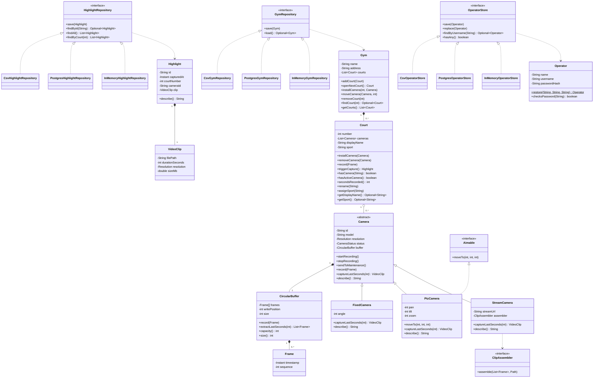

# Domain Model

The classes, their relationships and the reasons those relationships exist in
the delivered application.

## Class diagram

## Relationships

| Relationship | Cardinality | Type | Reason |
|---|---:|---|---|
| Gym → Court | 1 : 0..* | Composition | Courts belong to one gym; a new gym may start empty. |
| Court → Camera | 1 : 0..* | Aggregation | Cameras can be removed and moved between courts. |
| Camera → CircularBuffer | 1 : 1 | Composition | The buffer is private memory owned by one camera. |
| CircularBuffer → Frame | 1 : 0..* | Composition | Frames exist only as entries in a buffer. |
| Highlight → VideoClip | 1 : 1 | Composition | A highlight cannot exist without its clip metadata. |

Camera identifiers are unique across the whole gym. Installation therefore
goes through `Gym.installCamera(...)`; `Gym.moveCamera(...)` validates the
destination before removing the camera from its current court. A moved camera
arrives inactive and starts with an empty buffer when recording resumes.

`Gym.openNextCourt()` adds the court numbered one past the highest existing
one — court 1 on an empty gym — and returns it. The phone gets its own court
this way (`ConnectStreamCamera`), so the numbering rule lives in the gym rather
than in whoever needs a new court. `Gym.removeCourt(int)` takes a court out
only when it holds no camera: cameras outlive the court, so the operator
removes or moves them first, and highlights captured there are untouched.

`StreamCamera` hands its recorded window to a `ClipAssembler`, received in its
constructor, which writes the playable file and returns only once it exists.
It is the only thing the domain knows about real video; the FFmpeg
implementation, `FfmpegClipAssembler`, lives in `infrastructure/stream/`.

Aiming is a capability, not a kind of camera. `Aimable` declares only
`moveTo(pan, tilt, zoom)` and `PtzCamera` is its one implementation, so a
fixed camera or a phone is never made to answer an aim it cannot take. A
caller asks `camera instanceof Aimable`, not which class it holds:
`ManageGym.aimCamera` and `CameraView.isAimable` do exactly that.

A highlight stores the court number and camera identifier as values, rather
than keeping mutable references. It can therefore outlive both objects and be
rebuilt from CSV without reconstructing the capture equipment.

`Operator` is a staff account — name, username and password hash — and has no
association with any other class. A gym does not hold its operators, and a
highlight never names one: the account opens the window, while the capture
button carries no identity. The plain password is checked by the constructor
(at least 8 characters, with an uppercase and a lowercase letter, a digit and a
symbol), hashed with PBKDF2 and never retained. `Operator.restore` rebuilds an
account from a stored hash without hashing it again, and `checksPassword`
compares a candidate against it. Two operators are equal when their usernames
are, which are stored in lowercase.

## Object-oriented concepts

- **Encapsulation:** every field is private. Collections are returned as
  unmodifiable copies, and `CircularBuffer` never exposes its frame array.
- **Inheritance:** `FixedCamera`, `PtzCamera` and `StreamCamera` extend
  `Camera`; `NoActiveCameraException`, `EmptyBufferException`,
  `DuplicateCameraException` and `ClipAssemblyException` extend the abstract
  `DomainException`.
- **Polymorphism:** cameras implement `captureLastSeconds()` and
  `describe()` differently, and `Court.triggerCapture()` calls
  `captureLastSeconds()` through the `Camera` type.
- **Abstraction:** `HighlightRepository`, `GymRepository` and `OperatorStore`
  are contracts with CSV, PostgreSQL and in-memory implementations.
- **Interface segregation:** `Aimable` is kept apart from `Camera`, so only
  the camera that can turn implements `moveTo`.
- **Domain independence:** no class under `domain/` imports `application/` or `infrastructure/`
  or Swing.

## Persistence boundaries

`HighlightRepository` stores the highlight archive; `ExpireRecordings` removes the entries older than the retention period.
`GymRepository` stores the gym, courts, cameras, their status and PTZ
position. `OperatorStore` stores the operator accounts, never a plain
password. `CsvHighlightRepository` can recover valid highlights around a
damaged line; `CsvGymRepository` rejects a damaged structure as a whole so
the application never runs with half a gym.

## Deliberate omissions

There is no play type, match or highlight author, and no sport the system
classifies: a court's sport is a free label the operator chooses, read by no rule. The physical capture
button carries no identity, so the saved highlight contains only the instant,
court, camera and clip. Operators sign in to open the window, but that account
never reaches a highlight. Decoding video in Java and scheduling are outside
the project scope.
